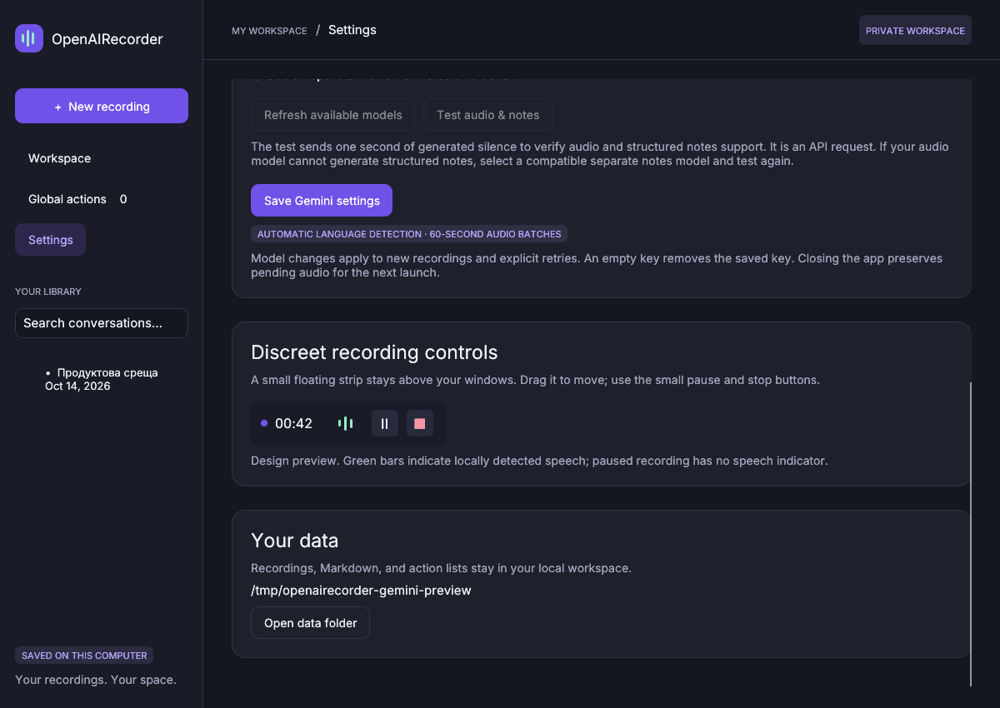

# OpenAIRecorder — Gemini meeting workspace

OpenAIRecorder 0.4 is a native Rust Windows app that sends recorded audio directly to Gemini in one-minute batches. It fills the transcript, cumulative Markdown notes, decisions, and action items as responses arrive. Whisper and subscription CLI agents have been removed.

[Gemini settings preview](docs/screenshots/gemini-settings.png) · [Light workspace](docs/screenshots/conversation-light.png) · [Dark workspace](docs/screenshots/conversation-dark.png). These are native Linux screenshots with sample meeting data, not live Google recognition results.

[Download the Gemini Windows x64 app](https://github.com/genchev/openairecorder/raw/refs/heads/main/downloads/OpenAIRecorder-Gemini-Windows-x64.zip)

Extract the ZIP and double-click `openairecorder.exe`. Keep `libunwind.dll` beside it. No setup scripts, Rust, or local speech models are required.

## Global Actions

Use **+ New task** to create personal tasks, or add a meeting action to the global list. **Edit** changes its title, owner, and optional due date. Choose a date from the calendar, type `YYYY-MM-DD`, use Today/Tomorrow/In 7 days, or clear it with No due date. Global edits and completion stay independent of the meeting's original action.

**Pin** highlights a task and promotes it above ordinary tasks. Open overdue tasks come first, then tasks due today, then tomorrow, then pinned tasks, then the remaining open tasks. Completed tasks stay last and lose deadline urgency; Hide completed removes them from view. Date labels and highlighting distinguish overdue, today, and tomorrow using the computer's **local calendar date**, and update automatically while the app runs.

Search covers task titles, owners, due dates, and source conversation names. Sort by due date (soonest/latest) or added date (newest/oldest) within priority groups. When sorting by due date, tasks without an exact date sort after dated tasks within their group. Older global actions without a recorded added date remain editable and display Added date unavailable; the app does not invent a historical date. Meeting deadlines such as “Friday” are kept as suggestions until you choose an exact calendar date; editing only a title/owner preserves that original suggestion.

[Dark task list](docs/screenshots/global-actions-dark.png) · [Light task list](docs/screenshots/global-actions-light.png) · [Task editor and calendar](docs/screenshots/global-task-editor.png). These screenshots use native Linux rendering with isolated demo tasks.

## Gemini settings

Open Settings, enter your **Gemini API key**, and refresh the available models. Choose an audio-capable model from your account's list, or enter a custom model ID. By default the same model transcribes audio and returns structured Markdown notes and actions.

**Test audio & notes** verifies the selected configuration with one second of generated silence. This is an API request; if combined notes fail but audio transcription works, the app enables and requires a separate notes-model choice. You can also choose separate models yourself: the audio model transcribes the segment and the notes model processes its text and meeting context. Save settings before recording.

Language detection is automatic, including Bulgarian. Prompts preserve the spoken language, mark unclear speech, and discourage invented speakers, names, owners, dates, and commitments. Recognition and summarization quality still depend on the chosen Google model and audio quality.

Gemini API availability, quota, and pricing apply separately from ChatGPT/Claude subscriptions. Model listing confirms availability, not audio support; use the capability test. [Google AI Studio keys](https://aistudio.google.com/apikey), [audio documentation](https://ai.google.dev/gemini-api/docs/audio), and [structured output documentation](https://ai.google.dev/gemini-api/docs/structured-output).

On Windows the key is encrypted with **DPAPI for the current Windows user** and stored separately in `gemini-key.bin`. It is not placed in recordings, Markdown exports, settings JSON, provider URLs, or request logs. Saving an empty key removes the stored key. The Linux development preview uses an owner-only key file rather than Windows encryption. Do not share that file.

## Recording and incremental notes

1. Name the conversation, select meeting/system audio and/or microphone, and confirm that participants know audio is being recorded and sent to Gemini.
2. Start recording. The conversation opens immediately, so you can watch its notes, transcript, and next steps fill in.
3. Each **60 seconds of recorded audio** produces a standalone WAV and queues a Gemini request. Capture continues while requests are processed sequentially. After each response, the transcript appends that segment and cumulative notes/actions update. This is minute-batch processing, **not word-by-word streaming**; response latency and backlogs are visible in the session.
4. Pause omits new audio and timer time without ending the session. Previously queued audio can still finish processing. Resume continues the same recording.
5. Stop saves the full recording and also queues the final partial minute. Leave the app open to finish processing, or close it and resume pending work on the next launch.

Capture uses the Windows default playback device, so Teams, Slack, Zoom, and other apps should play through that device. Other sound on that output can be recorded too. Use headphones to reduce echo. No video is captured.

Each minute uses approximately 1.92 MB of PCM16 WAV before Base64 encoding, below Gemini's 20 MB inline-request limit. Native audio is mono 16 kHz PCM16 WAV, about 115 MB per active hour, with a safety stop before 2 GiB.

## Discreet floating controls



The screenshot shows the clearly labeled Settings preview; the actual Win32 popup still needs Windows testing.

The movable, always-on-top recorder is a **234 × 52 logical-pixel strip**, scaled for your monitor. It has a recording/paused dot, timer, small pause/resume and stop buttons, and three speech-activity bars. It has no title bar or large form controls.

A local **WebRTC voice-activity detector** drives the bars, with a short hold to avoid flicker. It does not wait for Gemini, transcribe words, or identify people. Like other VAD systems it can misclassify noise or quiet speech. Paused recording has no speech indicator. The strip continues to work with the main window minimized. Settings includes a clearly labeled design preview; it is not a live microphone test.

## Notes and actions

The workspace keeps modern Light, Dark, and System themes, Cyrillic typography, session search, pins, formatted CommonMark notes, a full-transcript tab, and a next-steps panel.

Action updates match existing IDs or normalized titles. User completion flags and known metadata are preserved. Check actions off in the session or add open actions to Global actions. Global copies have independent completion and retain their source even after deletion. Notes can be edited after recording, exported, or imported from UTF-8 Markdown; explicit task checkboxes become actions. Ordinary bullets do not become invented tasks. Imported Markdown images are not fetched.

Gemini is asked to return the current segment's transcript only, plus cumulative notes and explicit commitments. Empty transcripts do not add invented notes/actions. User checkboxes remain authoritative. Successful responses are cached before committing the checkpoint; replaying a saved response does not append the transcript twice. A crash before a provider response is cached can still cause a repeat API request and possible repeat charges.

Each bullet or numbered point in **Key Points**, **Decisions**, and **Open Questions** has a small **+** button to create a session Action item. Corresponding Bulgarian headings are supported. The original point stays unchanged; the task is also written as a Markdown checkbox under Action items. The button becomes a checkmark after creation, and its link to the action survives AI rewording and restarts. Use the existing checkbox or Add to global control to complete/copy the task. Save pending Markdown edits before promoting a point. [Native preview](docs/screenshots/note-point-actions.png), with isolated sample data.

## Errors and recovery

Quota/rate-limit, transient server, and connection failures get bounded retries. Authentication, unavailable-model, unsupported-output, and other errors retain pending audio and show an actionable message. Update settings and choose **Retry pending audio**. Missing keys stop uploads; adding a key lets you explicitly resume processing. Successful processed chunk files are removed after commit, while the full original audio remains.

Interrupted native recordings recover readable WAV audio and reconstruct any final unqueued partial minute. The app also retains readable legacy portable recordings. Unsupported or corrupt audio cannot be guaranteed recoverable.

Existing/imported **mono 16 kHz PCM16 WAV** can be processed in one-minute batches. External imports remain limited to 150 MB. Other formats from older versions are preserved, but currently cannot be decoded for Gemini processing inside the app.

## Storage and privacy

Audio, text, and meeting context are sent to Google when you record/process with Gemini. The app does not copy account credentials or use browser sessions. Recordings and notes themselves are **not encrypted**; use a protected local drive.

Data normally lives in `%LOCALAPPDATA%\OpenAIRecorder\recordings`. An existing portable `recordings` folder next to the executable is reused. `RECORDER_DATA_DIR` selects an isolated initial workspace and location-file anchor for development; a saved move is followed on future launches. A session contains original `audio`, pending minute WAVs under `chunks`, `record.json`, `transcript.md`, `notes.md`, `live.json` (models/progress without a key), and cached Gemini results. `gemini-settings.json` stores model choices without credentials. Themes and global actions remain in the data root. Deleting a session removes its files; copied global actions remain.

## Move the workspace

In **Settings → Your data → Move data folder…**, choose or create an **empty folder**, then confirm the move. Recording and Gemini processing must finish first; save or cancel open edits. The app stops playback and pauses workspace commands while it copies and verifies every file. It then switches to the new folder immediately and removes the old files. Recordings, transcripts, Markdown, tasks, settings, pending audio, and the saved Gemini key move together; the key stays encrypted for the same Windows user.

The small location setting stays at `%LOCALAPPDATA%\OpenAIRecorder\workspace-location.json`, outside the default recording folder. Future launches follow this setting. Existing portable workspaces are supported too. With `RECORDER_DATA_DIR`, the locator stays in that original directory, which remains with only the location file after a successful move. Subsequent moves update the same locator, including when moving back to the original folder.

The original remains authoritative until copying, byte verification, and saving the location setting succeed. If an old file changes externally or cannot be removed afterward, the new workspace remains active and the app reports that old files were retained. A missing disk or invalid saved location produces an error rather than silently opening an empty workspace. Keep the app open while moving. The [workspace settings preview](docs/screenshots/workspace-settings.png) uses the native Linux development UI; the Windows version opens a standard folder picker.

## Development and validation

```bash
cargo build --locked
cargo test --locked
cargo clippy --locked --all-targets -- -D warnings
```

The app defaults to its native GUI. Linux `--desktop` previews the same interface with an X display; capture, playback, DPAPI, and the real floating strip are Windows-specific. Explicit `--web` exposes a loopback development API only, not a browser app. Cloud developer setup/build scripts are not distributed as end-user installers.

Tests use a local simulated Gemini API and do not consume provider quota. See [VALIDATION.md](VALIDATION.md). Live Google authentication, model accuracy, quotas, and physical Windows capture/DPAPI/widget behavior need testing on Windows with your own key entered in the app.

### Current affordable Gemini models (checked 2026-10-14)

The initial picker includes `gemini-3.5-flash-lite` (new default), `gemini-3.1-flash-lite`, `gemini-3.8-flash`, `gemini-3.6-flash`, and `gemini-3-flash-preview`. Saved model choices remain unchanged. Refresh available models replaces suggestions with the models exposed to your API key; use Test audio & notes before recording. Live, TTS, image, and dedicated transcription endpoints are not interchangeable with this app's `generateContent` workflow.

Google's standard paid prices per million tokens: 3.5 Flash-Lite is $0.30 audio input / $2.50 output; 3.1 Flash-Lite is $0.50 audio input / $1.50 output. The cheapest total depends on how much transcript, cumulative context, notes, and thinking each minute produces. 3.8 and 3.6 Flash are higher quality options, currently $0.75 input / $3.75 output through December 31, 2026, with announced increases afterward. These are token prices, not a fixed meeting price. Free-tier availability and quotas depend on the account.

Google restricts Gemini 2.5 access to projects with previous usage, which can explain a 404 on a new key/project. Sources: [model catalog](https://ai.google.dev/gemini-api/docs/models) and [pricing](https://ai.google.dev/gemini-api/docs/pricing).

Library rows have compact pin/archive controls; right-click a row for permanent deletion with confirmation. Deleting a different session preserves unsaved notes in the current session; copied global actions remain. Active recording/processing sessions cannot be deleted. The floating recorder paints the full dark button background and uses a purple keyboard-focus outline, avoiding light Windows button corners. The Settings preview uses the same pause/resume/stop shapes.

### Compact library and Archives

Library rows are 32 px tall, with a single left-aligned, truncated title. The two small buttons pin/unpin a session or archive it. Pinned conversations have their own section above ordinary conversations. Archives is a collapsible section; searching includes archived transcripts, notes, and actions and opens matching archive results. Archived sessions are excluded from the overview cards. The archive button becomes Restore inside Archives, and each archived session shows its scheduled deletion date. Right-click any row for permanent deletion.

Archiving clears the pin and records the archive time separately from the recording date. A confirmation explains the **30-day automatic deletion**. Repeated archive requests do not extend that deadline. Restore before expiry removes the deadline; archiving it again starts a new 30-day period. The app deletes the entire expired session directory, including audio, notes, transcript, and pending segments. Global action copies remain. Active recording/processing sessions are protected. Old session files without an archive date remain ordinary sessions.

Cleanup runs before startup recovery and during library refresh while the app is running. If the app is closed on the expiry date, files remain until the next launch; there is no background Windows service. Archives is a library grouping backed by each session's persistent metadata, rather than moving files that live processing might reference. The screenshot [compact library](docs/screenshots/library-archives.png) uses isolated demo data in the Linux native desktop build.

The application uses its purple/mint logo as the native window/taskbar icon. The Windows executable also embeds a seven-size icon resource (16–256 px) for Explorer and shortcuts. Icon source assets live under `assets/icons`; the packaged application does not need external icon files.

Development credit: [www.giga.tips](https://www.giga.tips).
