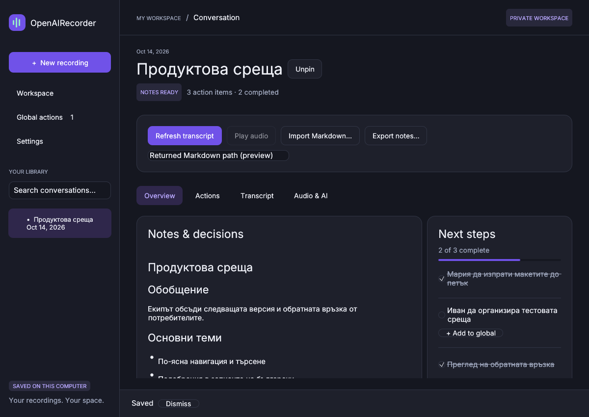

# OpenAIRecorder — native Windows workspace

OpenAIRecorder 0.3 is a native Rust desktop app for recording conversations, keeping readable Markdown notes, and managing next steps. The redesigned interface includes a violet/mint palette, Inter typography with Cyrillic support, rounded cards, a searchable library, tabbed conversation pages, and Light/Dark/System themes.



Native Linux preview with sample Bulgarian Markdown. [Light appearance](docs/screenshots/conversation-light.png). Windows uses native file dialogs and enables recording/playback.

[Download the Windows x64 app](https://github.com/genchev/openairecorder/raw/refs/heads/main/downloads/OpenAIRecorder-Native-Windows-x64.zip)

**Extract the whole ZIP, then double-click `openairecorder.exe`.** No setup scripts, PowerShell commands, Rust installation, or Visual C++ runtime installer are required for native recording, WAV playback, and Whisper transcription. Keep `libunwind.dll` and `.local-tools` beside the executable. The app opens a desktop window, without launching a browser or HTTP server.

## Your recording workflow

1. Name the conversation, choose meeting audio and/or microphone, and confirm that participants know you are recording.
2. Start recording. A movable, always-on-top widget provides Pause/Resume and Stop & save. Minimize the main window if you like; recording controls continue working.
3. Pause omits audio and timer time without closing the session. Resume continues the same WAV. Stop saves it.
4. Open the conversation and choose **Create transcript**. Whisper processes speech on your computer.
5. Under **Audio & AI**, choose an installed Codex or Claude Code agent, confirm sharing the transcript, and generate notes/actions using its existing subscription login.
6. Read formatted Markdown in Overview, check off next steps, or add open actions to Global actions. A global copy has its own completion state and retains its source even after session deletion.

Meeting capture records the Windows default output device, so Teams, Slack, or Zoom should play through that device. Other audio on that output may also be captured. Use headphones to reduce echo. No video is recorded.

## Bulgarian and Whisper

**Bulgarian is the default speech language.** Settings also offers English and Auto-detect, with the choice persisted between launches. This avoids relying on language detection for Bulgarian meetings; it does not guarantee recognition accuracy.

The download includes the checksum-verified multilingual Whisper tiny model and a statically linked Windows speech engine. Tiny prioritizes speed and can make recognition mistakes, particularly with Bulgarian, noisy recordings, and names. Download a larger **multilingual** `ggml-small.bin` or `ggml-medium.bin` from the [official model repository](https://huggingface.co/ggerganov/whisper.cpp/tree/main), then use **Settings → Choose a Whisper model**. Do not choose an English-only `.en` model for Bulgarian. Larger models need more memory and processing time. No recorder setup script is involved.

Native recordings are already mono 16 kHz PCM16 WAV, so Whisper and playback do not need ffmpeg for them. Imports accept audio/video up to 150 MB. Transcription of other imported formats requires an existing ffmpeg installation; alternatively import a mono 16 kHz PCM16 WAV. In-app playback supports mono PCM16 WAV. Native captures use about 115 MB per active hour and stop before the 2 GiB WAV limit.

## Markdown and action items

Notes render CommonMark headings, emphasis, lists, quotes, code, links, and tables. Images are not fetched from returned Markdown. Session action items appear in a separate next-steps panel with completion progress and **Add to global** controls.

You can import a UTF-8 `.md` file with **Import Markdown**. Task checkboxes such as these become structured actions:

```markdown
## Actions
- [ ] Мария да изпрати офертата
- [x] Преглед на обратната връзка

## Full transcript
**Мария:** Ще изпратя офертата.
```

Ordinary bullets do not become invented action items. The app preserves Bulgarian text and Markdown formatting. Reimported actions retain identity and existing completion; unchanged automatic imports do not overwrite later checkbox edits. Checks in the Markdown view and the next-steps panel stay synchronized in exported notes. The Markdown editor allows manual correction.

The app also watches `agent-output.md` in a session's folder and imports changed documents automatically. Use **Audio & AI → Open session folder** to find it. A Full transcript / Пълен препис heading populates the transcript tab when supplied.

For services that support audio uploads, **Audio & AI** can prepare a folder containing the original recording and processing instructions, and copy a Bulgarian-aware audio prompt. Import the returned Markdown afterward. **Codex CLI and Claude Code currently have no supported audio-attachment input**; the app does not pretend that passing them a WAV path makes them understand audio. The normal subscription-agent workflow uses Whisper's transcript.

## Subscription agents

The app detects installed Codex and Claude Code agents and reuses their existing subscription authentication. Settings links to the [official Codex setup guide](https://developers.openai.com/codex/cli/) and [official Claude Code setup guide](https://code.claude.com/docs/en/setup). Use the provider's setup and sign-in process if an agent is absent. Installing providers may be restricted by your organization; this app does not override those restrictions. The portable recorder itself has no setup-script requirement.

The app removes common API-key environment variables and rejects unsupported API-key/third-party authentication. Subscription usage and account limits still apply. Transcript text is shared only after you choose generation and confirm sharing. Agent activity and diagnostics appear under Audio & AI. CLI command detection alone does not establish usable sign-in or quota.

Codex uses read-only sandboxing with shell access and user configuration disabled. Claude uses safe mode with tools, MCP, and customizations disabled. No credential files are copied. The cloud's existing Codex sign-in returned HTTP 401 during live validation; provider generation needs a usable subscription login on your computer.

## Storage

Data normally lives in `%LOCALAPPDATA%\OpenAIRecorder\recordings`. An existing portable `recordings` folder next to the executable is reused to preserve older sessions and settings. Search covers titles, notes, transcripts, and action text; pinned sessions sort first.

Each session stores original audio, `record.json`, `transcript.md`, `notes.md`, and agent logs. Theme, speech preferences, and global actions are stored in the data root. Readable interrupted WAV captures are recovered at startup; unreadable capture files are retained. Files are not encrypted. Deleting a session removes its files, while copied global actions remain.

| Environment variable | Purpose |
| --- | --- |
| `RECORDER_DATA_DIR` | Override the data directory |
| `WHISPER_BIN` / `WHISPER_MODEL` | Override bundled speech defaults |
| `FFMPEG_BIN` | Optional decoder for other imported formats |
| `CODEX_BIN` / `CLAUDE_BIN` | Override agent executable paths |

## Development

```bash
cargo build --locked
cargo test --locked
cargo clippy --locked --all-targets -- -D warnings
```

Windows defaults to the native desktop. Linux `--desktop` previews the same GUI with an X display; audio capture/playback and native file dialogs are Windows-specific. `--web` is a legacy development interface on 127.0.0.1:8787; it has not received the desktop redesign. Linux without a mode still defaults to that development service.

Developer-only cloud build scripts prepare dependencies and cross-build Windows using checksum-verified LLVM-MinGW. `scripts/build-whisper-windows.sh` builds pinned whisper.cpp v1.8.7 as a static Windows executable, avoiding the prior MSVC DLL/runtime dependency. End users do not run these scripts. Inter's OFL notice and dependency licenses are included in the ZIP.

See [VALIDATION.md](VALIDATION.md) for test results. Physical Windows capture, pause/resume, device behavior, and widget appearance still need testing on Windows. The tiny model's Bulgarian recognition accuracy has not been established by the UI and configuration tests.
